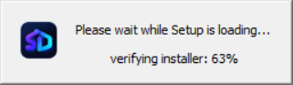
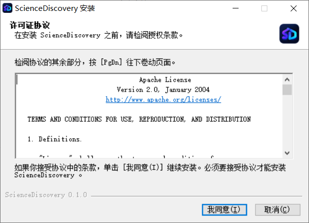
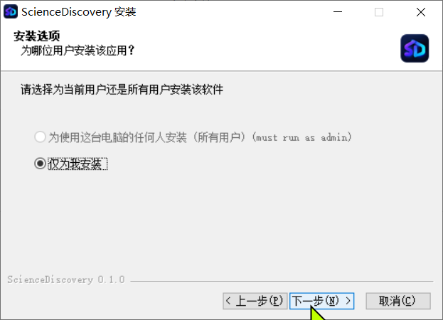
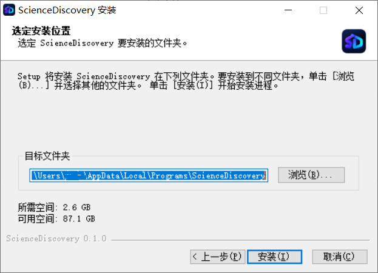
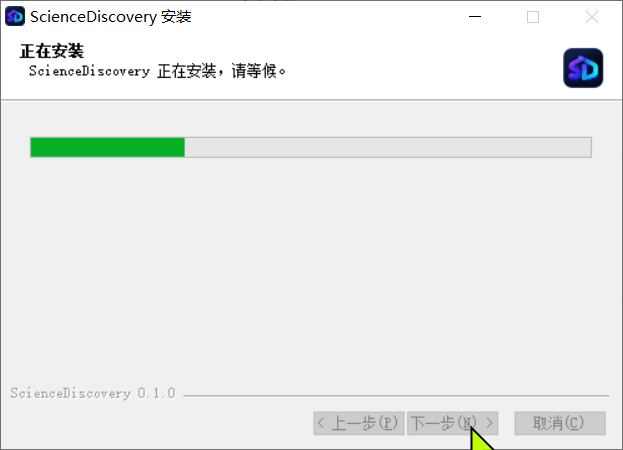
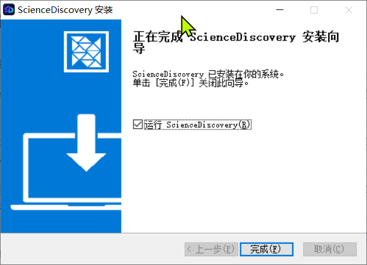

# Install ScienceDiscovery

Windows uses the desktop installer. Once it finishes you just open the app: no browser and no local service access token to paste.

The screenshots below show the installer and the first-launch wizard in Chinese; the controls are in the same places in other languages.

## Prerequisites

- Windows x64;
- about 2.6 GB of free space for the installation;
- 5 GB or more for the data directory, which prepares the Python runtime on first launch;
- at least one model provider API key.

## 1. Run the installer

Double-click the downloaded package:

```text
ScienceDiscovery-<version>-win-x64-setup.exe
```

The installer verifies and unpacks itself first. Seeing the loading window below is normal; it proceeds on its own.



## 2. Accept the license

The installer uses Apache License 2.0. Read the agreement and select **I Agree (我同意)** to continue.



## 3. Choose who to install for

- **Install for all users on this computer**: installs to a shared location and needs administrator rights;
- **Install for me only**: installs under your user profile, needs no elevation, and is the recommended choice on a personal machine.

Then select **Next (下一步)**.



## 4. Choose the install location

The default is `C:\Users\<your user name>\AppData\Local\Programs\ScienceDiscovery`. To use another drive, select **Browse (浏览)…** and pick a folder such as `E:\SD\`. The window shows the required and available space.

Select **Install (安装)** to continue.



## 5. Wait for the installation

Do not close the window until the progress bar finishes.



On the last page, keep **Run ScienceDiscovery (运行 ScienceDiscovery)** checked and select **Finish (完成)**. The wizard closes and the app starts.



## 6. First-launch setup

The first launch runs a three-screen setup wizard. You only go through it once.

### 6.1 Choose the research workspace

Artifacts, intermediate results and the runtime environment all live in this directory. The default is
`C:\Users\<your user name>\AppData\Local\ScienceDiscovery`, and the wizard shows the free space on that drive;
it needs at least 5 GB. Once **Directory is writable** is confirmed, select **Next**.


### 6.2 Wait while the environment is prepared

The first launch prepares the Python runtime and its dependencies inside the data directory, which can take
a few minutes up to a quarter of an hour depending on disk speed and antivirus software. You can minimize
the window; the first preparation is not interrupted.


### 6.3 Choose a model provider

Pick a preset provider under **Provider type** (DeepSeek, Moonshot Kimi, Zhipu GLM, Z.AI, MiniMax, Alibaba Cloud
Model Studio, OpenAI, Anthropic, Google Gemini, SiliconFlow, OpenRouter, Ollama, and others). To use a
self-hosted or relay service, choose **Custom (enter the address manually)** and fill in **API protocol**,
**Base URL**, **API key** and **Model name**. **Refresh list** fetches the available models again.

Then select **Test and continue**.


### 6.4 Connection succeeds

On success the wizard shows **Connection succeeded** with the round-trip time. Select **Start using** to open
the main window. If the test fails, check the API key, base URL and model name, then select **Test again**.


## Troubleshooting

### The installer asks for administrator rights

Only **Install for all users** needs elevation. Choose **Install for me only** to install with a normal user account.

### The installer stays on its loading window

That is the package verifying and unpacking itself and usually takes seconds. If it never advances, copy the
installer to a local disk (not a network share or inside an archive) and run it again.

### The first launch prepares the environment for a long time

The first launch downloads and unpacks the Python runtime and the scientific packages. Real-time scanning by
antivirus software makes this much slower; add the install and data directories to its exclusions. Later
starts take a few seconds.

### The model connection test fails

Check, in order: that the API key is valid, that the **Base URL** includes the right path (often ending in `/v1`),
that the **model name** matches the provider's own name, and that this machine can reach the service. For a proxy,
see [Configure a network proxy](../advanced-setup/configure-network-proxy.md).

### Change the workspace directory

Open **System settings** in the app, change the data directory, and restart as prompted. Reinstalling also lets
you pick a different install location.

### Uninstall

Open **Settings → Apps → Installed apps**, find ScienceDiscovery and uninstall it. Uninstalling leaves your
chosen workspace directory in place; delete it manually if you no longer need it.

## Where to go next

With the installation done, follow the [end-to-end walkthrough](quick-start.md) to take one complete task through
statistics, external evidence, review and tracing.
