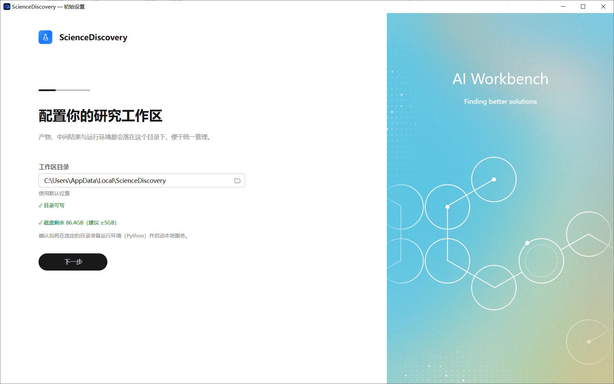
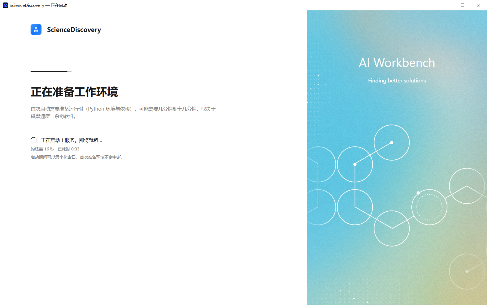
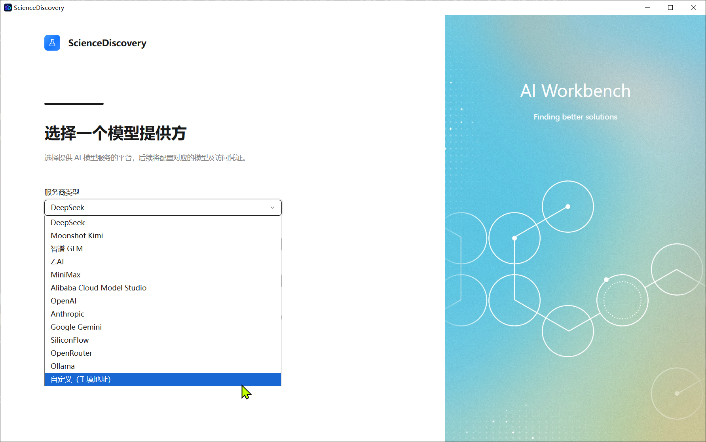
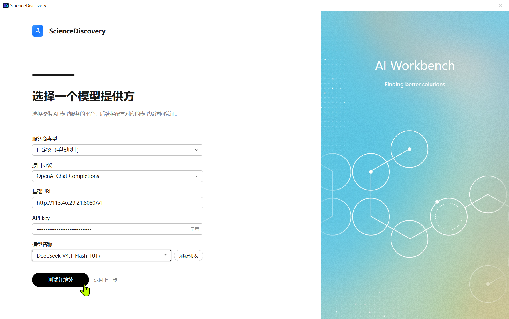
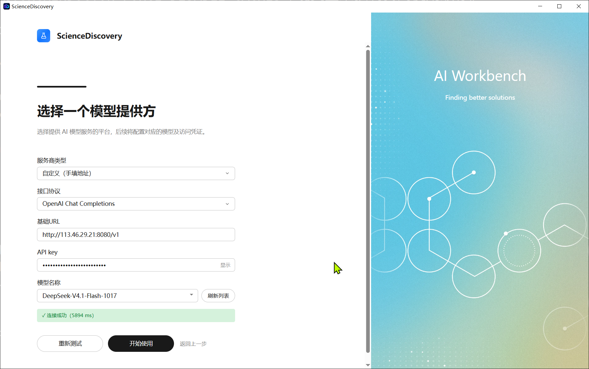
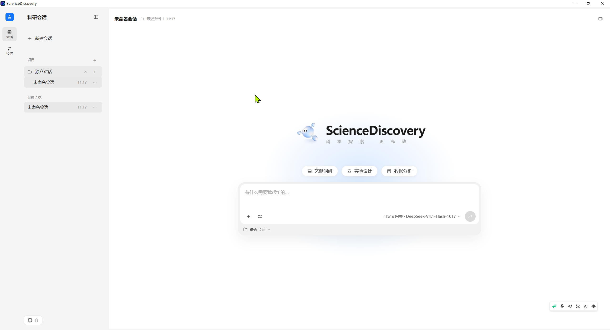

# 安装 ScienceDiscovery

Windows 使用桌面安装程序。装完之后双击就能用：不需要打开浏览器，也不需要手动粘贴本地服务访问令牌。

## 前置条件

- Windows x64；
- 安装目录约需 2.6 GB 空闲空间；
- 数据目录建议预留 5 GB 以上（首次启动会在其中准备 Python 运行时）；
- 至少一个模型服务商的 API Key。

## 首次启动设置

第一次启动是一个三屏的初始化向导，只需要走一次。

### 配置研究工作区

产物、中间结果和运行环境都会写在这里。默认目录是 `C:\Users\<你的用户名>\AppData\Local\ScienceDiscovery`，
下方会显示当前磁盘剩余空间，需要 ≥5 GB。确认 **目录可写** 后点击 **下一步**。

### 等待准备工作环境

首次启动要在数据目录中准备 Python 运行时和依赖，可能需要几分钟到十几分钟，取决于磁盘速度与杀毒软件。
中途可以最小化窗口，首次准备过程不会中断。

### 选择模型提供方

在 **服务商类型** 中选择预置服务商（DeepSeek、Moonshot Kimi、智谱 GLM、Z.AI、MiniMax、阿里云百炼、OpenAI、
Anthropic、Google Gemini、SiliconFlow、OpenRouter、Ollama 等）；如果要接自建或中转服务，选择
**自定义（手填地址）**，再填写 **接口协议**、**基础 URL**、**API key** 和 **模型名称**。
模型列表可以点 **刷新列表** 重新拉取。

填写完成后点击 **测试并继续**。

### 连接成功

测试通过后窗口会显示 **连接成功** 和耗时。点击 **开始使用** 进入主界面；
如果失败，先核对 API Key、基础 URL 和模型名称，再点 **重新测试**。

## 常见问题

### 安装时提示需要管理员权限

只有勾选 **所有用户** 时才需要提权。改选 **仅为我安装** 即可用普通用户完成安装。

### 安装程序打开后停在加载窗口

这是安装包自检和解压，通常几十秒内结束。长时间无进展时，把安装包移到本地磁盘（不要放在网络盘或压缩包内）后重试。

### 首次启动准备环境很慢

首次启动会下载并解压 Python 运行时和科学计算依赖。杀毒软件的实时扫描会明显拖慢这一过程；
可以先将安装目录和数据目录加入信任列表。准备完成后，后续启动只需要几秒。

### 模型连接测试失败

按顺序检查：API Key 是否有效、**基础 URL** 是否包含 `/v1` 之类的正确路径、
**模型名称** 是否与服务商提供的名称一致、这台机器能否访问该服务。需要代理时见[配置网络代理](../advanced-setup/configure-network-proxy.md)。

### 想更换工作区目录

在应用中打开 **系统设置**，修改数据目录后按提示重启；也可以在下次安装时更换安装位置。

### 卸载

打开 **设置 → 应用 → 已安装的应用**，找到 ScienceDiscovery 卸载。
卸载不会删除你选择的工作区目录，需要时手动删除。

## 下一步

安装完成后，跟着[端到端体验案例](quick-start.md)用一个完整任务把统计、外部证据、复核和追溯走一遍。
